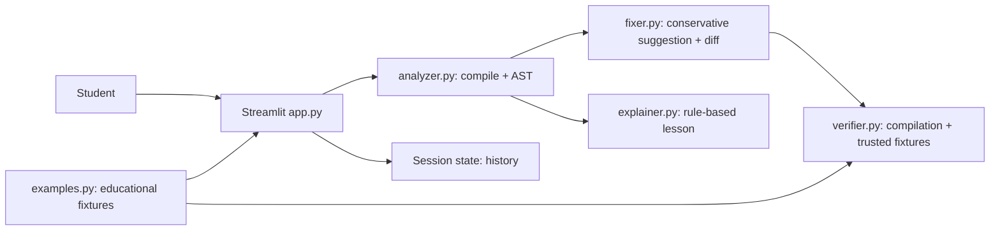

# BugWise AI — Explain. Fix. Verify.

BugWise AI is a small, local-first Python debugging assistant for the AIGEX 2K26 college AI challenge. It uses Python's parser, AST, conservative source edits, and fixture-based checks to make debugging understandable without requiring an LLM or API key.

## Problem statement

Beginning Python programmers often see an exception but do not know which line matters, why it happened, how to repair it, or whether a correction has actually been checked. BugWise AI brings those steps together while clearly distinguishing static evidence from runtime behavior.

## Objectives

- Detect syntax and indentation errors and selected name/literal-based risks.
- Explain findings in beginner-friendly language and connect them to Python concepts.
- Offer only limited, reviewable source suggestions.
- Verify compilation and show transparent results from trusted educational fixtures.
- Never execute user-submitted source in the Streamlit process.

## Features

- `compile()` and `ast.parse()` validation.
- Static unresolved-global checks plus literal checks for selected `NameError`, `ZeroDivisionError`, `IndexError`, `KeyError`, `TypeError`, `ValueError`, and `AttributeError` cases.
- Conservative typo, missing block-colon, and one-line indentation suggestions.
- Suggested corrections are compiled before they are exposed as corrections; candidates that fail compilation are not offered, and the failed change is identified as rejected in Fix Evidence.
- Supported literal list-index findings include separately labeled, syntax-checked Fix Options for guarding an access or iterating the list. Options describe their tradeoffs and do not choose a replacement index.
- `difflib` unified diff, beginner explanations deduplicated by Python concept, sample selector, Learning Mode, and in-session history.
- Ten educational examples, including syntax, common runtime risks, and logical mistakes.
- Syntax validation is reported consistently as “Syntax validation passed” or “Syntax validation failed.” Allowlisted trusted reference operations show expected-versus-actual behavior for exact educational samples and their known corrections, but do not run the candidate code and are not behavioral verification of a fix.
- Dark Streamlit interface and no API key.

### Architecture



## Technology stack

Python 3.10+, Streamlit, Python standard library (`ast`, `compile`, `symtable`, `difflib`), and pytest. No model download, database, or network service is required.

## Installation and run (Windows PowerShell)

From the project directory:

```powershell
python -m venv .venv
.venv\Scripts\Activate.ps1
python -m pip install -r requirements.txt
python -m streamlit run app.py
```

If PowerShell blocks environment activation, run the environment's executable directly:

```powershell
.venv\Scripts\python.exe -m pip install -r requirements.txt
.venv\Scripts\python.exe -m streamlit run app.py
```

This workspace may be under a deeply nested VS Code installation path, where Windows can hit `MAX_PATH` while installing dependencies. If that occurs, place the project source files at a short path such as `C:\AIGEX\BugWiseAI` (excluding `.venv`) and create the virtual environment there before installing requirements.

The local app URL is normally `http://localhost:8501`. No API key is needed. To run tests:

```powershell
python -m pytest -q
```

## Screenshots

Add presentation screenshots here after running the app locally. No screenshots are fabricated or included.

## Test results

Last local run: **18 passed** with Python 3.10.8, pytest 8.4.2, and Streamlit 1.65.0 (`python -m pytest -q`). The ten-example integration check and Streamlit Learning Mode demo flow also passed. Re-run the suite after any changes before presenting.

## Verification and safety limitations

- Submitted code is compiled and parsed but never passed to `exec()`, `eval()`, or a subprocess.
- A successful compile only says that the syntax is acceptable. It does not establish that the program runs correctly or computes the right answer.
- Trusted sample operations run against fixed fixture inputs in BugWise's own small allowlist. They demonstrate known behavior but are not an execution sandbox and do not run the suggested candidate.
- Static source analysis cannot reliably find every runtime failure. Dynamic behavior, user input, external services, and arbitrary package availability remain outside this version's verification.
- The NameError scan focuses on unresolved global references and may not model dynamic namespace changes.

## GitHub and Streamlit deployment

1. Create a GitHub repository yourself, then add/commit/push this project. Do not upload `.env`, `.venv`, or Streamlit secrets; `.gitignore` excludes them.
2. In Streamlit Community Cloud, connect the repository and choose `app.py` as the main file.
3. Keep the Python dependencies in `requirements.txt`. No secrets are needed for the current features.
4. If you later add an LLM key, store it in the deployment's secret manager and never commit it.

Publishing and account creation are intentionally left to the project owner.

## Future improvements

- Add a bounded, OS-enforced isolated runner only after a security review.
- Add more static rules, with false-positive-focused tests.
- Provide optional type checking and configurable trusted behavioral fixtures.
- Add accessible theme options and saved, user-controlled report export.
