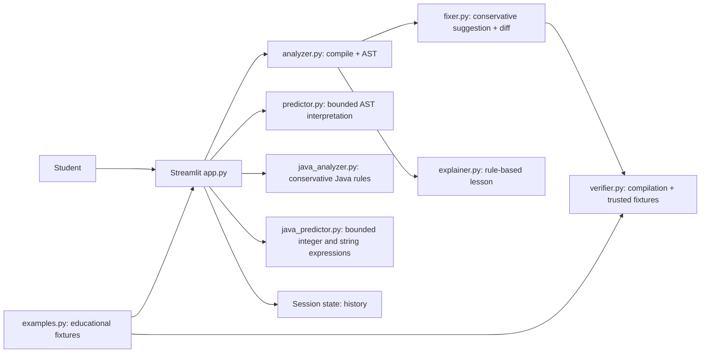

# BugWise AI — Explain. Fix. Verify.

BugWise AI is a small, local-first Python and Java debugging assistant for the AIGEX 2K26 college AI challenge. It uses static checks, conservative source edits, and fixture-based Python checks to make debugging understandable without requiring an LLM or API key.

## Problem statement

Beginning Python programmers often see an exception but do not know which line matters, why it happened, how to repair it, or whether a correction has actually been checked. BugWise AI brings those steps together while clearly distinguishing static evidence from runtime behavior.

## Objectives

- Detect selected Python issues and common beginner-level Java syntax/type issues.
- Explain findings in beginner-friendly language and connect them to language concepts.
- Offer only limited, reviewable source suggestions.
- Verify compilation and show transparent results from trusted educational fixtures.
- Never execute submitted source.

## Features

- `compile()` and `ast.parse()` validation.
- Static unresolved-global checks plus literal checks for selected `NameError`, `ZeroDivisionError`, `IndexError`, `KeyError`, `TypeError`, `ValueError`, and `AttributeError` cases.
- Conservative typo, missing block-colon, and one-line indentation suggestions.
- Suggested corrections are compiled before they are exposed as corrections; candidates that fail compilation are not offered, and the failed change is identified as rejected in Fix Evidence.
- Supported literal list-index findings include separately labeled, syntax-checked Fix Options for guarding an access or iterating the list. Options describe their tradeoffs and do not choose a replacement index.
- `difflib` unified diff, beginner explanations deduplicated by Python concept, sample selector, Learning Mode, and in-session history.
- Eleven Python and five Java educational examples identify what the static checks can establish and where behavior cannot be inferred.
- Syntax validation is reported consistently as “Syntax validation passed” or “Syntax validation failed.” Allowlisted trusted reference operations show expected-versus-actual behavior for exact educational samples and their known corrections, but do not run the candidate code and are not behavioral verification of a fix.
- A responsive dark developer-tool interface with Overview, Diagnosis, Suggested Fix, Fix Evidence, and Verification tabs; original and suggested source views; session-only activity metrics; and a practice hint/answer flow in Learning Mode.
- The suggested-code block exposes Streamlit's built-in copy control, with a separate download action. No browser-specific clipboard integration is required.
- **Analyze Code** performs static analysis and displays **Predicted Output — Not Executed** for bounded assignments, primitive arithmetic and values, `print()`, and determinable `if/else` branches. Syntax and known division/name errors are prediction diagnostics; unsupported code receives a clear unavailable message.
- The predictor accepts only a restricted AST allowlist with node, depth, numeric, string, source, and output size limits. Unsupported code is never executed.
- A language selector keeps Python as the default and adds a separate `java_analyzer.py` path for conservative semicolon, delimiter, `main` capitalization, simple declaration/type, and common `println` checks.
- Java fixes are limited to high-confidence text edits. Java compilation and behavioral verification are marked unsupported; no compiler or submitted-code runner is used.
- `java_predictor.py` predicts initialized `int`/`String` variables, reassignment, basic integer arithmetic, string concatenation, and `System.out.println` for a restricted statement sequence or conventional `main` wrapper. It keeps the **Predicted Output — Not Executed** label.
- No API key.

### Architecture



## Technology stack

Python 3.10+, Streamlit, Python standard library (`ast`, `compile`, `symtable`, `difflib`), and pytest. No model download, database, or network service is required.

## Installation and run (Windows PowerShell)

From the project directory:

```powershell
python -m venv .venv
.venv\Scripts\Activate.ps1
python -m pip install -r requirements.txt
python -m streamlit run app.py
```

If PowerShell blocks environment activation, run the environment's executable directly:

```powershell
.venv\Scripts\python.exe -m pip install -r requirements.txt
.venv\Scripts\python.exe -m streamlit run app.py
```

This workspace may be under a deeply nested VS Code installation path, where Windows can hit `MAX_PATH` while installing dependencies. If that occurs, place the project source files at a short path such as `C:\AIGEX\BugWiseAI` (excluding `.venv`) and create the virtual environment there before installing requirements.

The local app URL is normally `http://localhost:8501`. No API key is needed. To run tests:

```powershell
python -m pytest -q
```

## Screenshots

Add presentation screenshots here after running the app locally. No screenshots are fabricated or included.

## Test results

Run the complete local suite with `python -m pytest -q`. Python and Java analysis, fixes, prediction, unsupported verification, and Streamlit workflows have dedicated tests.

## Verification and safety limitations

- The analyzer and verifier parse/compile submitted text and use trusted fixture operations; they do not execute submitted source.
- Predicted output is not executed or verified output. It is produced only for the explicit `predictor.py` allowlist with AST and size limits. Unsupported syntax returns “Prediction unavailable for this code. The program was not executed.”
- Java analysis uses narrow text rules, not a full Java parser or compiler. Some scope-dependent type and variable issues are intentionally reported as possible or left undetected.
- Java verification is unsupported. Java prediction accepts only `int` and `String` declarations, simple assignments, `+`, `-`, `*`, `/`, and println expressions. Loops, conditionals, imports, method calls, other types, and unrecognized syntax are unavailable. Integer overflow is rejected; division by zero is reported as a predicted arithmetic error without partial output.
- A successful compile only says that the syntax is acceptable. It does not establish that the program runs correctly or computes the right answer.
- Trusted sample operations compute results for fixed fixture inputs. They demonstrate known reference behavior and do not run the suggested candidate.
- Static source analysis cannot reliably find every runtime failure. Dynamic behavior, user input, external services, and arbitrary package availability remain outside this version's verification.
- The NameError scan focuses on unresolved global references and may not model dynamic namespace changes.

## GitHub and Streamlit deployment

1. Create a GitHub repository yourself, then add/commit/push this project. Do not upload `.env`, `.venv`, or Streamlit secrets; `.gitignore` excludes them.
2. In Streamlit Community Cloud, connect the repository and choose `app.py` as the main file. The dashboard and recent history are held in Streamlit session state and are not permanent storage.
3. Keep the Python dependencies in `requirements.txt`. No secrets are needed for the current features.
4. If you later add an LLM key, store it in the deployment's secret manager and never commit it.

Publishing and account creation are intentionally left to the project owner.

## Future improvements

- Expand the predictor's supported AST subset with focused accuracy and safety tests.
- Add more static rules with false-positive-focused tests.
- Provide optional type checking and configurable trusted behavioral fixtures.
- Add accessible theme options and saved, user-controlled report export.
